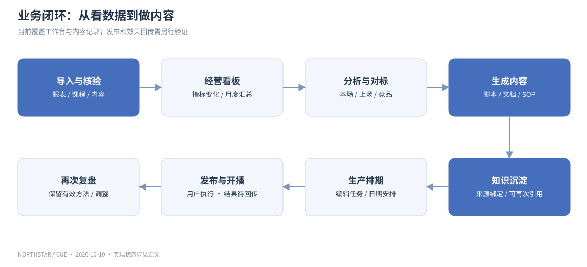
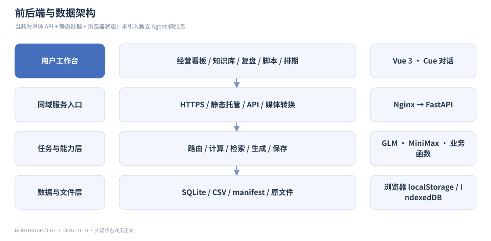
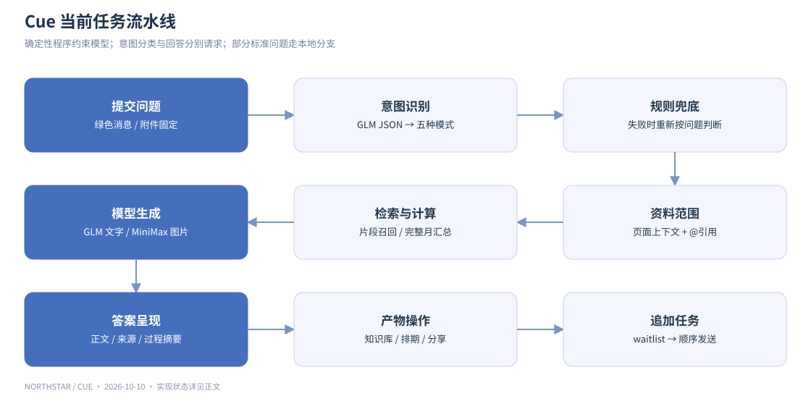
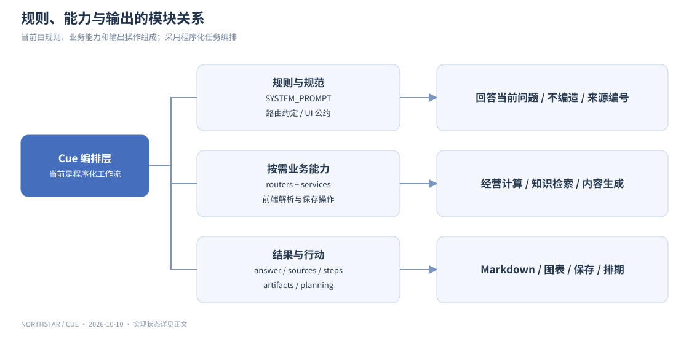
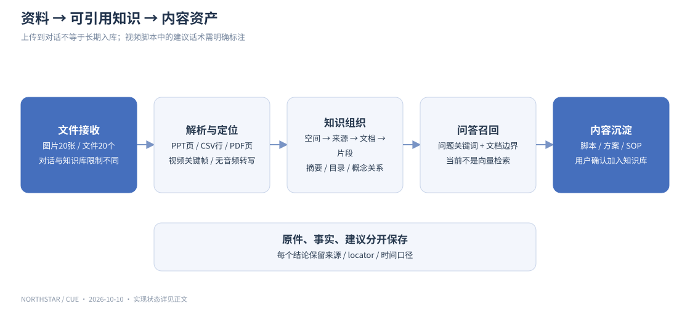
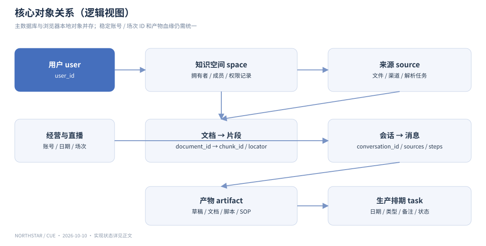
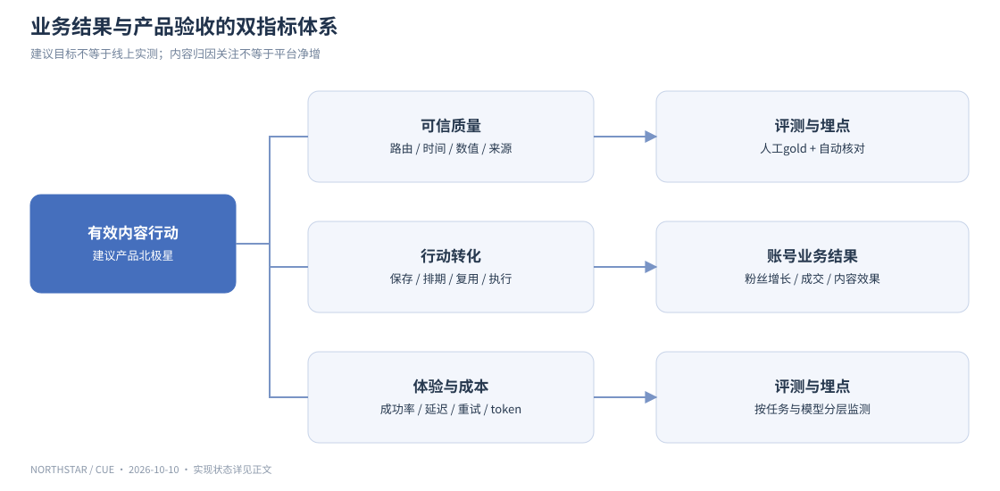
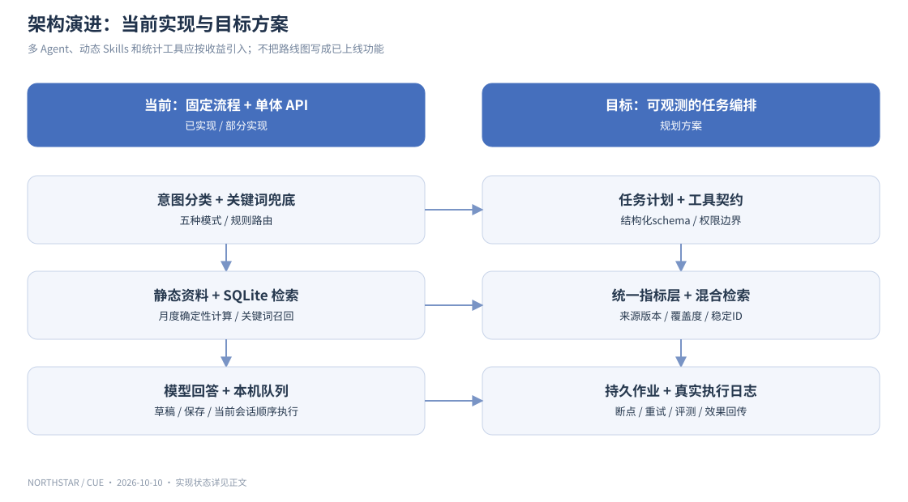

# NorthStar 产品与技术全景

**从经营数据到内容行动的 AI 工作台**

版本：2026-10-10 ｜ 产品：NorthStar / 北极星 ｜ 对话助手：Cue ｜ 生产域名：https://northstar-copilot.com/

本文面向产品、设计、工程、运营和业务负责人，依据当前项目源码与本轮部署检查整理。采用「产品定义 → 场景 → 架构 → Agent → 数据 → 指标 → 演进」说明 NorthStar。

**阅读约定**：已实现指当前代码具备该链路；部分实现指只有特定路径可用或仍有演示数据；规划指建议建设，不能视为已经上线。目标指标均为建议验收标准，未经线上测量。

## 01｜产品定义与价值

NorthStar 是面向教育内容账号及其运营团队的内容经营 AI 工作台。它把经营报表、直播复盘、课程知识、短视频脚本、竞品内容与生产排期连起来，让用户从「数据发生了什么」走到「下一条拍什么、下一场讲什么、形成什么可复用资产」。Cue 是工作台内的任务入口，页面提供数据和内容上下文，对话输出分析、脚本、方案和后续操作。

当前核心使用对象为「清华优优」教育内容账号；推广到其他创作者和团队属于产品方向，不应把单账号的演示配置理解为完整的行业 SaaS。

| 角色 | 经常遇到的问题 | NorthStar 的预期价值 |
|---|---|---|
| 账号负责人 | 看得到指标，但难以转成经营动作 | 汇总变化、明确数据边界、形成下一步决策 |
| 内容运营 | 选题、复盘、脚本、排期散落在不同工具 | 把一个问题串成一条生产流程 |
| 主播 / 老师 | 有知识但缺适合短视频和直播的表达 | 从课程或复盘资料转成口播、分镜和 SOP |
| 编导 / 剪辑 | 缺少清晰脚本、钩子和交付规范 | 获得可编辑的内容草稿和拍摄要求 |
| 数据 / 协作人员 | 报表口径不同、资料难追溯 | 统一来源、定位原文和核对数值 |

业务闭环是：导入资料 → 看经营变化 → 解释与对标 → 生成内容 → 知识沉淀 → 生产排期 → 发布或开播 → 再次复盘。当前平台覆盖其中的工作台、对话和记录环节，不能宣称已经自动发布视频或自动开播。

## 02｜产品目标与范围

**目标一：可信。** 回答中的数值来自指定报表或查询结果，区分真实导入、演示数据、截图估值和 AI 建议。找不到原文就明确缺失，不使用其他月份代替。

**目标二：可行动。** 不停留在泛泛建议。脚本输出应包括钩子、正文、口播、镜头和 CTA；SOP 输出应包括适用场景、步骤、检查点和复盘方法。

**目标三：可沉淀。** 生成结果可复制、分享、保存到知识库或加入排期。下一次分析可以重新引用已保存资料。

**目标四：不断流。** 问题提交后立即成为用户消息；回答生成中支持追加问题进入待发送队列。超限提供继续操作，避免输入框长时间锁死。

| 本阶段范围 | 状态与边界 |
|---|---|
| 经营看板、直播数据、脚本库、知识库、竞品对比、内容排期 | 已有页面和操作链路；部分模块仍使用示例资料 |
| 五类任务路由、GLM 文本问答、MiniMax 图片/视频关键帧理解 | 已接入；上下文、检索与失败恢复仍需持续测试 |
| 文档、表格和媒体附件解析 | 已有多格式路径；前端附件与登录知识库上传限制不同 |
| 会话、回答操作、待发送队列 | 已有交互；访客记录属于本机浏览器存储 |
| 向量检索、自动工具选择、多子 Agent、统计沙箱 | 尚未实现完整生产链路 |
| 定时无人值守执行、平台自动发布、账号级全量自动同步 | 不能作为已完成能力承诺 |

## 03｜核心需求与验收原则

| 优先级 | 需求 | 验收要点 |
|---|---|---|
| P0 | 本轮问题决定任务类型 | 改变问法仍能路由；不能把「直播多久」回答成内容总结 |
| P0 | 上下文准确绑定 | 当前脚本正文、当前直播、@资料及附件在发送时固定下来 |
| P0 | 时间和数值正确 | 月度统计覆盖全月场次；历史 / 当前 / 后续按实际日期判断 |
| P0 | 回答可读且有来源 | Markdown 标题、加粗、表格正常渲染；来源标题与摘要限制高度 |
| P0 | 失败可解释、可恢复 | 区分模型连接、超时、输出截断、解析失败；保存问题和资料 |
| P1 | 内容沉淀与下一步 | 文档 / 方案 / SOP / 脚本提供保存或排期入口 |
| P1 | 会话与队列 | 新建、历史恢复、连续提问、取消排队条目，不覆盖新草稿 |
| P1 | 内容生产编辑 | 编辑项保留颜色，其他变灰；卡片身份不因重绘丢失 |
| P1 | 附件易用 | 拖拽或左下角＋；区分图片 / 文件；限制说明与错误可见 |
| P2 | 持久任务与评测 | 后台作业恢复、路由和取数评测、团队权限、通知和审计 |

统一回答规范包含：可折叠过程摘要、使用资料来源、可读正文、操作工具栏，以及适用时的产物与下一步。**「思考过程」应展示可核验的执行摘要，而不是模型隐藏推理。** 当前部分步骤标签由程序生成，不等于逐步工具调用日志，后续需要绑定实际执行事件、耗时和失败原因。

## 04｜场景与交付物

| 用户问题 | 主要任务 | 应使用的资料 | 交付物 / 下一步 |
|---|---|---|---|
| 本场直播内容总结？ | 分析 | 当前场次、内容记录、关键画面 | 内容结构、亮点、风险、来源 |
| 和上一场数据对比，总结一下 | 分析 / 下钻 | 两场同口径报表、时长、主题 | 对比表、差值、增长率和待验证原因 |
| 本场直播时长多久？ | 指标查询 | 当前场次的原始时长字段 | 一句直接回答与报表来源 |
| 为什么 2025 年 7 月销售额高？ | 下钻 | 全月所有场次、成交额和观看数据 | 总额、头部场次贡献、可验证假设 |
| 课程 PPT 哪些内容能用于直播？ | 拆解 / 创意 | PPT 页级原文、直播 SOP | 可用知识点、直播结构、口播草稿 |
| 优化当前脚本 | 创意 | 当前脚本完整正文 | 优化稿、理由、口播和分镜 |
| 视频拆成脚本 | 拆解 | 上传视频的抽样帧、已有字幕 | 时点分镜、画面分析、建议话术 |
| 人气高点、下单高点的话术沉淀为 SOP | 创意 | 高光节点、话术、关联指标 | SOP 文档 → 知识库 → 下次复用 |
| 查看 AI 详细竞品分析 | 分析 / 拆解 | 当前竞品对比资料 | 差异化机会、选题建议 → 保存 / 排期 |
| 把刚生成的脚本加入下周排期 | 排期 | 最近产物、明确日期、内容类型 | 可编辑生产任务及保存结果 |

复合问题可以包含多个输出，但必须围绕本轮问题组织。对话历史用于理解「这个」「刚才」等指代，不应把旧问题未经要求重复合并进答案。

## 05｜信息架构与页面关系

经营看板负责经营概览和下一步建议；直播复盘负责单场和历史表现；短视频脚本与直播脚本负责内容产物；知识库负责资料和知识资产；对标账号及竞品对比负责外部内容参考；内容排期负责执行安排。Cue 跨页面提供统一任务入口。

知识库按知识空间组织资料，存在课程、脚本、经营数据等子库视图。空间中的文档、概念与来源是不同对象：文档是内容载体，概念是解析后的知识组织结果，来源记录文件或接入渠道。概念关系图目前主要根据文档 AI 解析结果构建，不是通用图数据库。

排期以四周为一个展示窗口，分为短视频选题、短视频脚本、拍摄发布、直播选题脚本、直播开播五条生产线。历史计划和后续计划需要绝对日期约束；本轮补充的任务属于用户授权编排的计划草案，不是已经完成的业务事实。

## 06｜前后端技术架构

| 层 | 当前实现 | 主要职责 |
|---|---|---|
| 前端应用 | Vue 3、Vite、共享 store | 页面、会话、附件、排期和当前页面上下文 |
| 内容渲染 | marked、DOMPurify、lucide-vue-next、SVG | Markdown、清理不安全 HTML、图标与趋势图 |
| 浏览器存储 | localStorage、IndexedDB | 访客会话、草稿、排期与本地原文件 |
| 应用 API | FastAPI、Pydantic、httpx | 鉴权、知识库、数据接口、Cue、媒体解析 |
| 主业务存储 | SQLite northstar.db | 账号、业务记录、知识空间、消息与产物 |
| 数据补充 | CSV 原件、JSON manifest、liveHistory.json、business.sqlite | 导入报表、演示资料及结构化查询 |
| 模型接入 | TokenHub 兼容 chat/completions | GLM 文字任务，MiniMax 多模态任务 |
| 媒体解析 | 本地 Swift / OCR；线上 ffmpeg / LibreOffice | 视频抽帧、PPT / 旧版 Office 转 PDF |
| 部署 | 腾讯云 Ubuntu、Nginx、systemd、HTTPS | 静态页面、API 代理、证书和后端进程 |

前端通过同域 `/api` 调用业务接口，生产环境由 Nginx 转发至本机 FastAPI。`/local-media` 在本地由 Vite 中间件提供，在生产由新媒体路由提供；两条路径要分别验证，不能仅凭本地可用断言线上可用。

当前没有独立的 Agent 微服务、向量数据库或消息队列。SQLite 和静态数据适合当前验证阶段，但任务规模、账号数量和资料量增长后，应拆出对象存储、后台解析任务与可扩展的检索服务。

## 07｜Cue Agent 的当前实现

Cue 当前是受程序约束的任务编排层：前端提交问题和上下文，后端选择任务路由、检索资料、调用模型、返回回答和产物。业务函数负责具体操作，模型不拥有任意执行权限。

### 五种用户任务与内部路由

| UI 类型 | 语义 | 内部路由示例 |
|---|---|---|
| 分析 | 概览、对比、原因解释、经营判断 | structured_query、hybrid_analysis、knowledge_qa |
| 下钻 | 按时间、场次、维度查看明细 | metric_drilldown、source_lookup |
| 拆解 | 内容结构、钩子、话术与竞品表达 | content_breakdown、competitor_rewrite |
| 创意 | 脚本、文档、方案、SOP | creative_generation |
| 排期 | 将内容建议转成生产安排 | hybrid_planning；前端请求中部分路径映射为 creative |

前端先请求 `/api/cue/intent`。GLM 输出五种模式之一；失败时通过关键词规则兜底。后端再用 `cue_routing.py` 判断具体路由。该方案不是新增的小模型，也不是已训练的专用意图分类器。

**上下文内容**：当前短视频脚本、当前直播脚本、当前直播复盘、当前竞品对比、@引用文档、近期直播、账号 KPI、已有排期、历史对话和上传图片。待发送队列会保留提交时的资料快照，避免页面切换改变排队任务的证据范围。

**模型分工**：默认文字任务使用 `glm-5.2`；包含图片等多模态消息时使用 `minimax-m3`。模型名来自服务端配置，不在前端放置 API 密钥。此分工表示调用选择，不等于已验证模型具备完整视频音频理解能力。

### 控制规则与能力模块

当前「规则层」位于 `SYSTEM_PROMPT`、路由规则和 `AI-UI-CONVENTIONS.md`。职责包括：回答当前问题、资料只作证据、不得编造指标、来源编号、Markdown 输出和受限图表格式。当前「能力层」由后端 services、routers 和前端解析函数实现。

后续可以把规则与业务能力整理成独立模块，按任务加载。当前仓库没有运行时动态能力加载器，设计分层与实际文件结构应分别说明。

## 08｜检索与分析流程

**访客路径**读取静态资料 manifest，按文本片段与标题命中排序，最多选取若干候选片段。最近补充的指定月份查询会读取全量直播 JSON，计算当月成交总额、观看人次、场次数与头部场次。该确定性计算修复了「只搜到六个片段，误认为整月只有这些数据」的问题。

**登录路径**按 `user_id` 查询知识库，支持空间和指定文档范围。文档分块默认约 800 字、重叠约 100 字；检索以英文词和中文二元字词的覆盖度排序，默认召回最多 8 个片段。当前不是向量 RAG，也没有成熟的混合检索和重排模型。

**分析边界**：当月汇总、同比或环比差值可以确定性计算；「为什么销售高」需要话题、商品、流量来源、时长等证据。头部场次贡献能说明总额由哪些场次构成，不能独自证明某句话造成成交增长。

建议后续统一为：问题 / 实体 / 时间解析 → 数据源计划 → 指标计算或资料检索 → 覆盖度检查 → 答案草稿 → 数值与引用校验 → 可视化 → 产物操作。访客和登录路径应共享同一套计算与证据接口，避免功能分叉。

## 09｜附件、媒体与知识沉淀

| 类型 | 当前处理方式 | 实际限制与边界 |
|---|---|---|
| 图片 | 压缩为 JPEG 后交给 MiniMax | 输入最多 20 张，原图每张 ≤20 MB；最长边缩至约 1600 像素，不是原图逐像素传输 |
| 对话文件 | XLSX、PPTX、CSV、TSV、MD、TXT、PDF、DOCX 等解析 | 最多 20 个，每个 ≤500 MB；格式接收与正文可解析是两项不同保证 |
| 旧版 PPT / XLS | 通过 LibreOffice 转 PDF 后提取 | 需要服务端转换工具；不同文件仍可能解析失败 |
| 登录知识库上传 | 服务端读取与分块 | 当前 `MAX_BYTES` 为 50 MB，正文上限约 20 万字符；与对话附件上限不同 |
| 视频知识资料 | 保存原片，抽样最多 8 帧，再调用 MiniMax | 视频路径当前上限 200 MB；没有音频逐字转写 |
| 原始 PPT 预览 | 生成 PDF 后在页面内预览 | 保留幻灯片版式；不能等同于浏览器原生编辑 PPT |
| 表格预览 | 按工作表渲染网格 | 展示解析值，不是完整 Excel 公式计算引擎 |

本地视频流程还有画面 OCR；线上新流程使用 ffmpeg 抽帧。两者均不能自动把未转写音频当成真实口播。应分别标注画面证据、抽样时间点、建议话术和缺失信息。

「上传」「解析」「加入知识库」也需要区分：临时对话附件会用于回答，不代表已经形成长期知识资产。加入知识库才是明确的保存动作。访客原文件保存在浏览器 IndexedDB 或由静态资料提供，不等于已同步到其他设备。

当前对话资料存在长度截取和总上下文限制，20 个大文件的接收不等于全文同时进入模型。后续应采用逐文件异步解析、摘要索引、针对问题召回和可见的覆盖度提示，避免静默截断。

## 10｜数据结构与对象关系

| 对象组 | 表 / 结构 | 关键字段与关系 |
|---|---|---|
| 用户与身份 | users、sessions | user_id、用户名、密码哈希、会话令牌和到期时间 |
| 账号经营 | kpis、northstar、trend、portraits 等 | 当前为业务展示表，部分字段来自种子数据 |
| 直播 | live_sessions、live_notes、live_scripts；liveHistory.json | 日期、标题、时长、观看、峰值、成交、内容卡片与原件定位 |
| 内容 | scripts、videos、library、benchmarks、virals | 脚本、视频、资料、竞品与内容表现 |
| 排期 | planning_tasks、gantt、gantt_weeks | 类型、标题、planned_at、状态、备注；图形窗口是展示投影 |
| 知识空间 | knowledge_spaces、knowledge_space_members | 空间所有者、成员与角色记录 |
| 数据来源 | knowledge_sources、knowledge_sync_jobs | 来源类型、URI、解析阶段、进度、错误和文档数量 |
| 知识内容 | knowledge_documents、knowledge_chunks | 文档归属空间，片段关联文档并保留 locator |
| AI 会话 | cue_conversations、cue_messages | 用户、模式、消息正文、路由、来源、步骤和产物 |
| AI 任务与产物 | cue_tasks、cue_artifacts | 周期任务定义；产物内容、类型和来源 |
| 访客状态 | localStorage、IndexedDB | 本机聊天、反馈、排期、模板编辑与上传原文件 |

注意：旧 `live_sessions` 与 `live_notes` 用日期作主键，多场同一天的直播无法仅凭日期唯一识别；前端部分选场也依赖日期。应迁移为稳定的 `live_id`，日期和开始时间作为属性。模板卡片与真实排期应同样使用稳定 ID，不能用对象引用判断是否正在编辑。

建议新增或统一字段：`account_id`、`source_type`、`source_id`、`period_start/end`、`metric_definition_id`、`verified_at`、`is_demo`、`is_estimated`、`artifact_id`、`derived_from`。这些属于目标模型，不是当前所有表已有的字段。

## 11｜经营指标与计算口径

| 指标 | 口径 / 算式 | 需要明确的边界 |
|---|---|---|
| 粉丝净增 | 新增关注 − 取消关注 | 净增与内容归因关注不是同一指标 |
| 播放量 | 平台报表的播放次数 | 不等于独立观看人数 |
| 观看人次（月） | 当月各场观看人数相加 | 跨场未去重，不能命名为全月独立用户 |
| 在线峰值 | 单场最高同时在线 | 截图曲线节点与原报表可能口径 / 估值不同 |
| 直播时长 | 平台原始时长 | 一场必须精确绑定，不能从曲线截图推算代替 |
| 成交金额 | 平台报表 GMV 字段按场求和 | 不自动等于到账收入、扣退款收入或利润 |
| 增长率 | (本期 − 上期) ÷ 上期 | 上期为 0 时不计算常规增长率 |
| 场次贡献 | 某场 GMV ÷ 月度 GMV | 是构成贡献，不是因果归因 |
| 转化率 | 明确分子 ÷ 明确分母 | 下单人数 / 观看人数，与订单数 / 商品曝光不同 |
| 完播率 / 互动率 | 使用平台定义或明确计算式 | 缺少底层字段时不能自造分母 |

**可复核例子**：当前导入的直播历史 CSV 共 261 条记录，覆盖 2025 年的历史场次。2025 年 7 月为 48 场，累计观看 143,374 人次，成交金额 ¥97,849；2025 年 10 月为 47 场、56,820 人次、¥24,352。这些是历史报表结果，不表示今天 2026 年 10 月的经营表现。

月度图必须读取完整月份数据；零值与缺失值分开。截图提取曲线标明估读，汇总指标使用原报表。示例：2025-11-15 原表峰值 140，而截图节点约 131；两者应并列注明证据口径，不能无提示覆盖。

## 12｜北极星与验收指标

**业务北极星**可以延续产品看板中的粉丝增长目标，结合成交表现，衡量账号经营结果；它受选题、平台分发、直播和商品等多因素影响，不能把增长全部归功于 AI。

**产品北极星建议**：每周有效内容行动数。定义为「有依据的 AI 产物经过用户确认并进入知识沉淀、排期或实际生产」的去重数量。单纯生成一条回答不计为行动；实际发布 / 开播还需后续业务回传验证。

| 维度 | 建议指标 | 建议验收目标 / 测量 |
|---|---|---|
| 意图 | 五类路由准确率、改写问法鲁棒性 | ≥95%；使用人工标注的多页面测试集 |
| 数据 | 数值准确率、时间范围正确率、来源覆盖率 | 关键金额和时间必须与 gold 一致；时间正确率 ≥98% |
| 回答 | 任务完成率、事实与建议区分、脚本可用性 | 按任务 rubric 评分，记录缺失资料与失败原因 |
| 可靠性 | 请求成功率、超时率、重试成功率 | 分模型、任务复杂度、附件类型统计，不混为一个均值 |
| 体验 | 首条用户消息展示延迟、排队丢失率 | 提交立即展示；会话内队列顺序和附件不能丢失 |
| 产物 | 保存率、加入排期率、产物复用率 | answer_id → artifact_id → task_id 的事件链追踪 |
| 活跃 | WAU、周留存、有效任务 / 活跃用户 | 登录用户与访客分开，明确跨设备去重规则 |
| 成本 | 每任务 token、模型费用、解析成本 | 记录模型、重试次数与产物完成情况 |

所有上述百分比为产品目标，并非当前线上实测成绩。现有点赞 / 点踩属于本机反馈，不是已经建立的集中评测数据仓库。

建议埋点：`question_submitted`、`intent_resolved`、`retrieval_completed`、`answer_completed`、`answer_failed`、`continue_clicked`、`queue_added/removed`、`artifact_saved`、`planning_created`、`source_opened`。记录 request_id、conversation_id、route、耗时、错误类别及来源 ID；避免把整份敏感正文直接写入普通监控日志。

## 13｜超时、队列与恢复机制

简单问题的模型请求预算为 60 秒；复杂问题为 180 秒。当前复杂判断包括：继续操作、图片、多文档、较长问题，以及生成、改写、SOP、趋势、对比、结合、原因等关键词。这里采用程序规则，没有专用小模型。

**实际工程边界**：当前预算主要约束模型调用，不是包含分类、解析、检索和网络上传的端到端硬截止时间。线上代理等待设置为 210 秒；分类和回答是两次请求。后续应统一总 deadline，避免界面说 3 分钟而完整操作超过 3 分钟。

「继续」当前会携带原问题、历史和资料重新请求，并给予复杂任务预算，不是模型的原地断点续写。超时与输出不完整返回结构化错误；网络连接错误应另外标识，不应全部提示用户重新配置模型。

待发送队列目前在前端依次执行，保留附件与提交时上下文，支持删除排队问题；它不是服务端耐久作业队列。刷新、关闭页面或切换设备的恢复尚需建设。会话保存和后台长期任务需要分开定义。

`cue_tasks` 当前有周期配置的存储与 API，但未发现完整的生产调度执行器。创建了任务定义不等于已自动按时执行和推送。

## 14｜可视化与内容交付规范

AI 正文由 Markdown 渲染，支持标题、粗体、列表、表格和代码块；渲染前通过 DOMPurify 清理不安全标签。来源区域限制标题和摘要高度，避免整份长文挤满对话。

当前 `chart` 代码块接受 `title/unit/labels/values`，生成简易 SVG 趋势折线；不是通用第三方 chart-render 服务，也不支持所有统计图。图表序列必须与正文、表格和来源同口径；缺失值不能补零。

直播趋势图是独立组件，支持在线人数、成交金额、A/B/C 标注及悬停信息。页面曲线、关键画面和复盘话术应使用同一场次标识；示例卡片不能被描述为逐场真实回放。

回答工具栏提供复制、重新生成、点赞、点踩和分享；分享在支持时调用系统分享，否则复制文本。不能把文本分享按钮描述为已经生成公网可访问的持久分享页。

## 15｜部署拓扑与交付检查

生产应用目录 `/opt/northstar`，前端静态目录 `/opt/northstar/frontend/dist`，后端 `/opt/northstar/backend`，业务数据库 `/opt/northstar/backend/data/northstar.db`。Nginx 负责 HTTPS 与代理，systemd 服务名 `northstar`。

本轮发布前备份应用代码、静态页面、后端数据及服务端环境文件；保留原数据库和非模型配置，更新 GLM / MiniMax 配置。依赖补充包括 LibreOffice 和中文字体；线上媒体请求由 `/local-media` 转发至 FastAPI。代理文件大小调整至 510 MB，为单文件请求预留空间，不表示支持无限并发大文件。

发布验收矩阵：静态首页与资源版本 → API 健康 → GLM 文本问答 → 多模态请求 → PPT 预览 → CSV 原文不自动下载 → 日期筛选 → 选中编辑颜色 → 会话与队列 → 保存知识和排期。当前已检查线上健康、GLM 简单问答和 PPT 转 PDF；其余要在真实浏览器和登录 / 访客两种路径继续回归。

部署到云端不会自动搬迁用户浏览器 localStorage / IndexedDB 中的会话、修改和上传文件。跨设备使用需要显式导入或服务端同步；当前页面里的本地资料不能被误认为已全部进生产数据库。

## 16｜现有问题与演进路线

| 阶段 | 工作重点 | 具体交付 |
|---|---|---|
| 当前稳定版 | 完成真实网站回归 | 双身份路径、附件、上下文快照、来源、排期和错误恢复 |
| 数据可信版 | 统一事实与指标层 | 报表导入版本、稳定 live_id、账号和日期过滤、数字 gold 测试 |
| 知识生产版 | 完整入库与检索 | 对象存储、后台解析、覆盖度提示、混合检索与出处定位 |
| Agent 工程版 | 统一编排与工具契约 | 工具注册、输入输出 schema、实际 trace、重试、断点和持久队列 |
| 运营增长版 | 连通生产效果 | 产物 → 发布 / 开播 → 结果回传，周期任务与协作权限 |

建议的 Agent 能力目录可分为：经营查询、直播复盘、竞品拆解、内容创作、知识检索、排期执行和媒体解析。每一类包含：适用任务、输入 schema、数据来源、计算方法、输出规范、失败恢复、测试样例。主编排器按任务加载规则和工具，再根据实际执行日志输出过程摘要。

需要进一步分析或统计检验时，再加入受约束的计算工具。A/B 检验、回归和时序预测必须具备合适样本、实验设计与口径，这些能力需要单独实现和验证，目前不属于 NorthStar 的已上线能力。

## 17｜典型端到端流程：从直播高光到 SOP

1. 用户选中一场直播，提交「把人气与下单高点话术沉淀为 SOP」。
2. 固定本场 ID、时间、报表指标、关键节点、可用话术和来源。
3. 路由到创意任务，读取复盘资料；缺少逐字稿时明确内容证据不完整。
4. 确定性计算节点附近指标变化，AI 组织话术结构和适用条件；不能推断未经证实的成交因果。
5. 输出 SOP：具体问题 → 阶段判断 → 金句 → 回应评论 → 匹配产品 → 自然介绍 → 复盘。
6. 用户选择加入知识库，保存文档与引用；再选择加入下次排期，生成可编辑任务。
7. 下一场使用该 SOP，回传观看、停留、成交等同口径指标，决定是否复用。

当前实现能提供复盘资料、AI 草稿和保存入口；完整的节点窗口计算、逐字稿绑定与发布效果回传属于后续建设。

## 18｜代码导航与证据依据

| 关注点 | 主要代码位置 |
|---|---|
| 全局数据归一化、访客资料与排期 | `frontend/src/store.js` |
| 对话、上下文、意图分类、队列、产物操作 | `frontend/src/components/CopilotPanel.vue` |
| Markdown 与 chart 渲染 | `frontend/src/components/AnswerMarkdown.vue` |
| 五种模式与细分路由 | `backend/app/services/cue_routing.py`、`backend/app/routers/cue.py` |
| 模型选择与服务调用 | `backend/app/services/model_client.py`、`backend/app/config.py` |
| 表结构与业务初始化 | `backend/app/database.py` |
| 知识空间、解析、分块、检索 | `backend/app/services/knowledge.py`、`backend/app/routers/knowledge.py` |
| 文件解析与浏览器原件保存 | `frontend/src/data/parsePresentation.js`、`knowledgeLocalFiles.js` |
| 媒体本地 / 线上路径 | `frontend/server/localVideo.js`、`backend/app/routers/media.py` |
| PPT、表格和直播图表组件 | `PresentationPreview.vue`、`SpreadsheetPreview.vue`、`LiveTrendChart.vue` |
| 日期、排期和卡片身份 | `frontend/src/data/planningPeriods.js`、`views/PlanningView.vue` |
| 完整历史直播样本 | `frontend/src/data/liveHistory.json`、静态 CSV 原件 |
| 统一交互约定 | `AI-UI-CONVENTIONS.md` |

这份文档是当前实现的审计与目标蓝图。新增功能、上线验证范围和指标实测结果，应随版本更新记录；不能把设计目标、示例资料和生产成绩混写。
